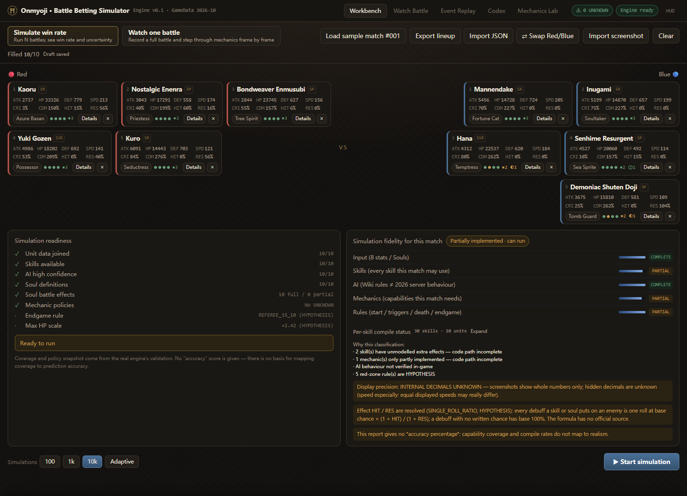
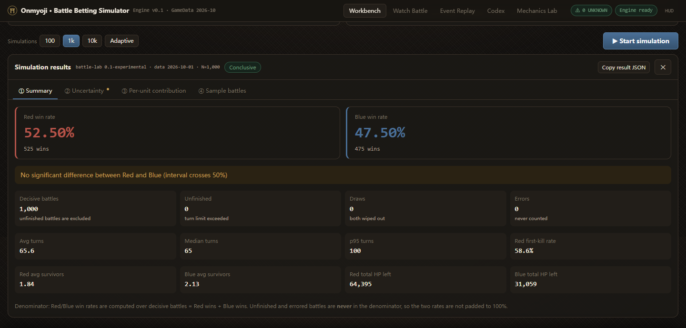
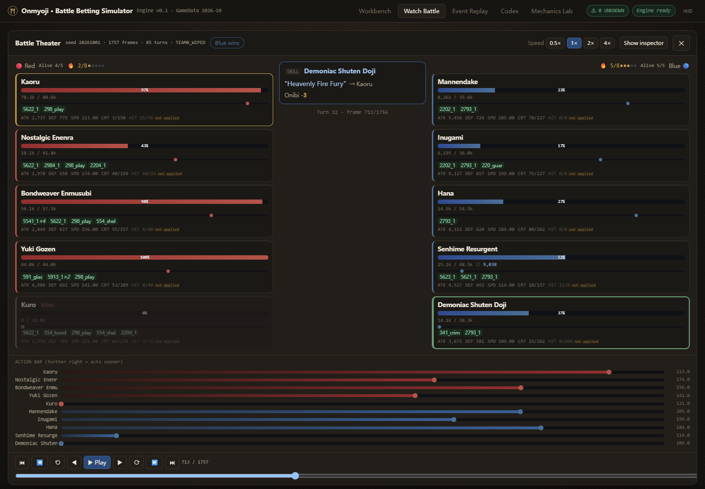

# Onmyoji · Duel Betting Simulator

> Not an animation remake, and not a tier-list site.
> A **battle calculator that is allowed to say "I don't know"**: feed it the two 5-shikigami lineups from the
> Duel Betting (对弈竞猜) Lineup screen, and a discrete-event engine resolves the fight action by action,
> then Monte Carlo gives a win rate with a confidence interval.

<p align="center">
  
</p>

[](#quick-start)
[](LICENSE)
[](#status-and-limits)

---

## What it computes

The public input of a betting round is tiny:

```
10 shikigami  +  80 stat numbers from the Lineup screen  +  10 soul icons
```

Skills, AI, buffs and soul mechanics are **not** part of the input. The project joins them from a knowledge base,
runs thousands of battles in the zero-dependency `battle-lab` engine, and shows the result in the browser.

| What you see | What the engine actually does |
|---|---|
| "Red 58%" | N independent seeds with a Wilson interval; unfinished or crashed battles never enter the denominator |
| Two lineup cards | The Lineup values are authoritative final stats; soul set bonuses are never added on top |
| "Not conclusive" | The interval crosses 50%, so the UI refuses to call it |
| "Watch battle" | A frame-by-frame recording from the same kernel: action bar, onibi, HP, AI inspector |

<p align="center">
  
</p>

---

## Duel betting mode (MAX)

Betting rounds are simulated in **MAX mode** (`setSkillLevelMode("MAX")`, the default in the web worker and in
`matches/run-lineup.ts`):

- **Max skill levels** for every skill, no onmyoji.
- **Effect HIT / RES**: one roll at `base × (1 + HIT) / (1 + RES)`.
- **Referee endgame**: the referee runs on the action bar like a unit (SPD ~114); each time it acts, all units
  deal more damage. Healing is not cut. Measured from replays.
- **Crit resistance** (e.g. Suzuhikohime's Undying Flame).
- **Max-HP scale ×2.42**: in betting rounds each unit's real max HP is about 2.42× the Lineup HP, while per-hit damage
  matches the formula. This was measured from replays: Suzuhikohime's 13% HP cost, Garuda's 10% max-HP heal.
- **Hand-written kits** for about 60 shikigami (`battle-lab/compile/betting-*.ts`) and betting-only souls.
  Generic passives are off on this path, so every kit whose mechanics live in passives is written and tested by hand.
- **User-confirmed AI behaviour** (`matches/observed-behaviour.json`) takes precedence over the old wiki AI table.

Rules that are not confirmed by an official source are marked **HYPOTHESIS** in the UI, with their evidence.

### Calibrated against replays

Replays of past rounds are recorded and analysed frame by frame: skill order, damage numbers, heals, deaths.
The first divergence from the simulation points at the mechanic to fix. This is how the HP scale, Yato no Kami's
wedges, Luminary Oitsuki's onibi gauge, 593's counters and targeting, and Garuda's and Doujo's heals were found.

---

## The workbench

Five views share one engine and one contract. Pages and stores never import the engine; only `adapters/` and
`workers/` touch `@engine`.

| View | What it does |
|---|---|
| **Workbench** | Enter 10 shikigami (or import a screenshot / JSON) → readiness + fidelity checks → 100 / 1k / 10k battles |
| **Watch battle** | Record one full battle and replay it at any speed |
| **Event replay** | Event-stream inspector for any seed |
| **Codex** | 276 shikigami, 70 souls and the official glossary, searchable |
| **Mechanics lab** | The open questions, each UNKNOWN / HYPOTHESIS / VERIFIED |

- **Import from screenshot**: paste (Ctrl+V) or drop the Lineup screenshots. Local OCR (tesseract.js) reads names
  and all 8 stats, soul icons are matched against reference icons, and doubtful cells are highlighted. Nothing
  leaves your machine.
- **English UI**: workbench, results, replay and theater (skill and buff text, AI conditions, battle log, banners) use Global terminology. The Codex and the Mechanics lab still show some Chinese.

<p align="center">
  
</p>

---

## Three rules that are enforced, not hoped for

1. **Three stat sources.** Betting uses the Lineup's final values; only the build path uses `BASE + EQUIPMENT`.
   Adding a 2-piece crit-damage bonus on top of a Lineup value would turn 164% into 184%, so it throws.
2. **Three precision layers, no intermediate rounding.** Raw soul precision → ExactStats (battle) → DisplayStats (UI).
   Two "SPD 180" units may be 180.42 and 180.11. The only rounding entry point is `battle-lab/kernel/gamemath.ts`.
3. **Unknown mechanics are policies.** Startup order, simultaneous-trigger priority, death/transform/revive and the
   endgame are switchable policies with a status of `UNKNOWN | HYPOTHESIS | VERIFIED`. Values are never invented silently.

---

## Status and limits

**The win rates are experimental. Do not treat them as betting advice.**

Recorded betting rounds and their real results are in `matches/` (14 rounds so far, all with results). The model
called 10 of the 13 clear-cut ones right. The remaining misses are mostly teams that win by sustain. Any shikigami without a
hand-written kit runs with an incomplete kit, and the unit tiles mark it (○ / ◐).

---

## Quick start

Requires **Node ≥ 22** (the engine uses native TypeScript type stripping: `node file.ts` just works).

### Web workbench

```bash
cd apps/web
npm install
npm run dev          # http://localhost:5173/
```

Production preview: `npm run build`, then `node tools/serve-ui.mjs` from the repo root (or double-click `启动UI.bat`).

### A betting round from the command line

```bash
# screenshots → lineup file
node apps/web/tools/parse-lineup.ts out=matches/<round>-lineup.en.json red.png blue.png
# Monte Carlo (MAX mode)
node matches/run-lineup.ts file=matches/<round>-lineup.en.json n=300
# one seed, per-unit damage and skill use
node matches/inspect-match.ts file=matches/<round>-lineup.en.json seed=100000
# JSON for the web "Import JSON" button
node matches/to-ui-json.ts file=matches/<round>-lineup.en.json
```

### Engine checks

```bash
node battle-lab/tests/m0.ts                  # empty battlefield
node battle-lab/tests/guessing-rules.ts      # betting rules
node battle-lab/tests/betting-mechanics-11.ts
```

See [battle-lab/README.md](battle-lab/README.md) for more commands.

---

## Repository layout

```
├─ battle-lab/        battle engine (no third-party dependencies)
│  └─ compile/betting-*.ts   hand-written MAX-mode kits
├─ apps/web/          Vue 3 + Vite + Pinia workbench
├─ data/kb/           derived knowledge base + English text (en-text.json, en-names.json)
├─ matches/           recorded betting rounds, CLI tools, observed in-game behaviour
├─ tools/             KB / submit / local UI server
├─ submit/            readable Markdown snapshot
├─ docs/screenshots/  README screenshots
└─ 02~10-*.md         research notes (Chinese)
```

"No third-party dependencies" applies to **battle-lab** only; the web app uses vue, pinia, vite, pinyin-pro and
tesseract.js.

---

## License

Code: [MIT](LICENSE). *Onmyoji* and its shikigami, skills, souls and terms belong to NetEase. This project is
unofficial and not affiliated. See [NOTICE.md](NOTICE.md).
